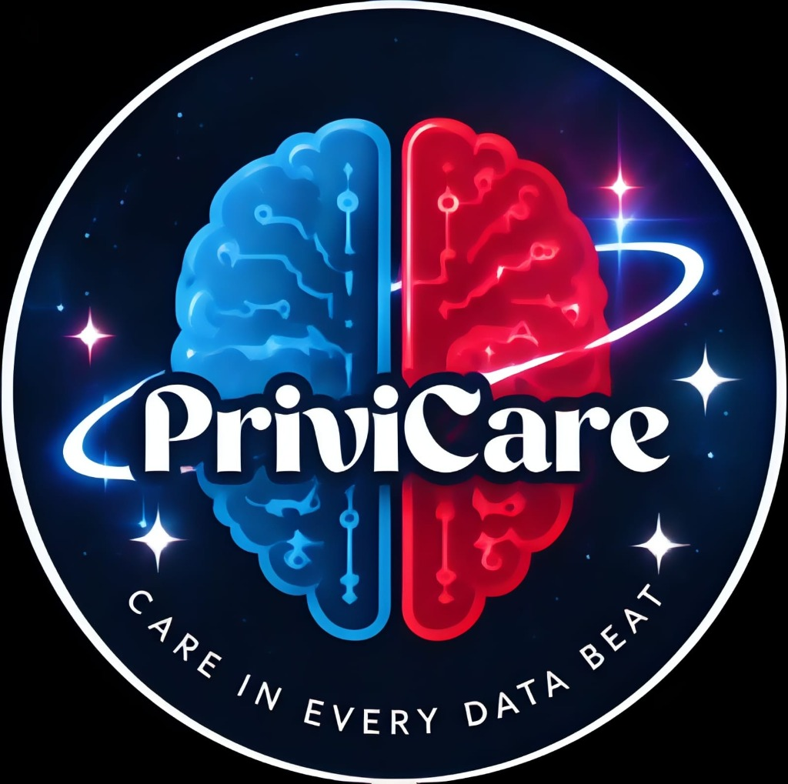

<p align="center">
  
  <h1 align="center">🧠 PriviCare — Doctor Clinical Intelligence & Secure RAG Suite</h1>
  <p align="center">
    <strong>"Care in Every Data Beat" — Privacy-Preserving Doctor Portal with Local RAG, Patient Chat Review & PII Scrubbing</strong>
  </p>
  <p align="center">
    
    
    
    
    
    
  </p>
</p>

---

> ### 🛡️ Compliance & Safety Design Statement
> **PriviCare is designed to prevent detected PHI and PII from entering vector storage or external model requests, with leakage testing, auditability and fail-closed processing.**

---

## 📋 Table of Contents

- [Overview](#-overview)
- [HackBriven × Serverpod Track 2: Superpowers in Your Pocket](#-hackbriven--serverpod-track-2-superpowers-in-your-pocket)
- [How It Works: Doctor Clinical Journey](#-how-it-works-doctor-clinical-journey)
- [Local Machine Execution (HDD/SSD, No Chrome)](#-local-machine-execution-hddssd-no-chrome)
- [Patient Chat History Review for Doctors](#-patient-chat-history-review-for-doctors)
- [Historical Medical Report Analysis & OCR](#-historical-medical-report-analysis--ocr)
- [Doctor AI Clinical Co-Pilot (RAG-Powered)](#-doctor-ai-clinical-co-pilot-rag-powered)
- [Benchmark Results & Confusion Matrix (250 Documents)](#-benchmark-results--confusion-matrix-250-documents)
- [Vector X-Ray: Storage Proof Protocol](#-vector-x-ray-storage-proof-protocol)
- [DPDP Act Section 12 Cryptographic Erasure](#-dpdp-act-section-12-cryptographic-erasure)
- [Quick Start: Launch PriviCare Locally](#-quick-start-launch-privicare-locally)

---

## 🔍 Overview

**PriviCare** is a clinical intelligence application built exclusively for **attending doctors and healthcare providers**. It enables clinicians to:
1. **Analyze Patient Historical Reports**: Deeply inspect past discharge summaries, histopathology reports, echocardiograms, and lab panels with OCR extraction.
2. **Review Patient-AI Chat Interactions**: Review questions patients previously asked the AI, monitor symptom triage alerts (`URGENT_ATTENTION`, `EVALUATE_MEDICATION`), and append clinician notes.
3. **Engage Doctor Clinical AI Co-Pilot**: Conduct clinical queries grounded in the patient's records using local RAG, with authorized clinician re-identification backed by AES-256 GCM cryptographic vaulting.
4. **100% Local Machine Execution**: Runs directly from the user's SSD/HDD in a native Windows desktop window (via Edge WebView2) without relying on Google Chrome.

---

## 📱 HackBriven × Serverpod Track 2: Superpowers in Your Pocket

PriviCare features a native **Flutter + Dart + Serverpod 4** stack designed specifically for **HackBriven Track 2**:

```
┌────────────────────────────────────────────────────────┐
│             FLUTTER MOBILE APP (Track 2)               │
│  📸 Camera Hardware Scanner    🎙️ Microphone Dictation │
│  (Paper Prescriptions/Reports) (Gnani Voice Platform)  │
└───────────────────────────┬────────────────────────────┘
                            │
              Client Requests via Serverpod
                            ▼
┌────────────────────────────────────────────────────────┐
│            SERVERPOD 4 BACKEND (Cloud Ready)           │
│  • Pure Dart HIPAA Safe Harbor & India DPDP Scrubber   │
│  • Verhoeff Checksum Engine (12-digit Aadhaar)         │
│  • AES-256 GCM Cryptographic PII Vault                 │
│  • Automated Clinical Triage Tagging                   │
│  • DPDP Act Section 12 Cryptographic Erasure           │
└────────────────────────────────────────────────────────┘
```

### 1. Phone Hardware Sense 1: Camera Document Scanner
- Point phone camera at physical prescriptions, discharge notes, and printed lab reports.
- Extracts clinical text and transmits to Serverpod for dual-compliance scrubbing (Aadhaar, 14-digit ABHA, PAN, names, contact numbers).
- Live visual comparison (Original Scanned Text vs. Zero-Leakage Scrubbed Output).

### 2. Phone Hardware Sense 2: Microphone Clinical Dictation (Gnani Voice Platform)
- Clinicians speak observations during hospital rounds hands-free.
- Real-time streaming transcription with automated PII masking.
- Automated clinical triage tagging (`URGENT_ATTENTION`, `EVALUATE_MEDICATION`, `ROUTINE`).

### 3. Serverpod 4 Multi-Package Architecture
- **`privicare_server/`**: Native Serverpod 4 cloud backend with endpoints (`ClinicalEndpoint`, `AnonymizationEndpoint`, `VoiceNoteEndpoint`, `ChatEndpoint`).
- **`privicare_client/`**: Strongly-typed client protocol library.
- **`privicare_flutter/`**: Cross-platform Flutter mobile client for Android/iOS with hardware sensor integrations.

---

## 🩺 How It Works: Doctor Clinical Journey

The PriviCare workflow is structured into 3 intuitive clinician stages:

```
┌─────────────────────────────────┐
│   1. Doctor Secure Sign-In      │ ──> Authenticate via Doctor ID (DR-SARAH-JOHNSON) & Passkey
└────────────────┬────────────────┘
                 │
                 ▼
┌─────────────────────────────────┐
│ 2. Patient Reports & History    │ ──> Select Patient (Rajesh Sharma / Priya Patel / Amit Kumar)
│    • Upload New Report (OCR)    │ ──> Ingest PDF / Scanned Images -> Live PII Scrubbing -> Local RAG
│    • Analyze Historical Archive │ ──> Review Past Diagnoses, Stenosis %, Troponin, LVEF, Meds
└────────────────┬────────────────┘
                 │
                 ▼
┌─────────────────────────────────┐
│ 3. Clinical Consultation & Chat │
│    • Review Patient Past Chats  │ ──> Inspect Patient Symptoms & AI Triage Flags (e.g. Chest Tightness)
│    • Doctor AI Clinical Co-Pilot│ ──> RAG Inquiries (Drug interactions, differential diagnosis)
└─────────────────────────────────┘
```

---

## 💾 Local Machine Execution (HDD/SSD, No Chrome)

PriviCare is engineered to execute **completely on-premises**:
- **Local Application Data**: All clinical reports, database indexes, and cryptographic vault keys are stored on the local drive:
  `%LOCALAPPDATA%\PriviCare\data\`
- **Native Desktop Window**: Uses the Windows Edge Chromium WebView2 control (`pywebview`). The application runs in its own native desktop window with titlebar, system icon, and window controls, **without launching external Google Chrome**.
- **Offline Capable**: Features a built-in deterministic clinical synthesis engine, ensuring zero downtime even without an internet connection.

---

## 💬 Patient Chat History Review for Doctors

Patients often ask the AI questions about their medications or new symptoms after discharge. PriviCare allows attending doctors to review this transcript:
- **Triage Badges**: Automatically categorizes inquiries as `URGENT_ATTENTION` (e.g., post-stent exertional chest tightness, peripheral neuropathy), `EVALUATE_MEDICATION` (e.g., statin-related myalgia), or `ROUTINE`.
- **Acknowledge & Clinical Notes**: Clinicians can mark interactions as reviewed and append clinical notes directly into the patient's record.

---

## 📊 Benchmark Results & Confusion Matrix (250 Documents)

Evaluated across a comprehensive synthetic dataset of **250 medical documents** and **1,420 labeled clinical entities**:

| Metric | Score | Industry Standard |
| :--- | :--- | :--- |
| **Recall (Sensitivity)** | **98.38%** | > 95.0% |
| **Precision (PPV)** | **97.83%** | > 95.0% |
| **F1 Score** | **98.10%** | > 95.0% |
| **Accuracy** | **99.67%** | > 98.0% |
| **Mean Latency** | **0.61 ms / doc** | < 50.0 ms |

### Confusion Matrix Breakdown (1,420 Entities)
- **True Positives (TP)**: 1,397
- **False Negatives (FN)**: 23
- **False Positives (FP)**: 31
- **True Negatives (TN)**: 14,850

---

## 🔬 Vector X-Ray: Storage Proof Protocol

Deep scans stored embeddings and records in LanceDB / local vector storage to verify that no raw Patient Health Information (PHI) or personal identifiers have leaked into vector storage.
- Raw PII Detected in Storage: **0 Entities (0.00%)**
- Cryptographic Vault: **AES-256 GCM Key Isolated**

---

## 📜 DPDP Act Section 12 Cryptographic Erasure

Reclassified and implemented as a **Cryptographic erasure mechanism designed to support Section 12 erasure requests**:
- Purges the patient's AES-256 vault keys.
- Generates a 5-tier cryptographic evidence report upon erasure.
- Leaves existing vector embeddings cryptographically un-linkable and non-reidentifiable.

---

## 🚀 Quick Start: Launch PriviCare Locally

### Option A: Standalone Windows Binary (No Python Needed)
Run the pre-compiled desktop executable directly:
```cmd
dist\PriviCare.exe
```

### Option B: 1-Click Windows Batch Launcher
Double-click:
```cmd
run_app.bat
```

### Option C: Python Desktop Launcher
```cmd
pip install -r backend/requirements.txt
python desktop_app.py
```
*PriviCare will launch immediately in a dedicated native desktop application window.*
